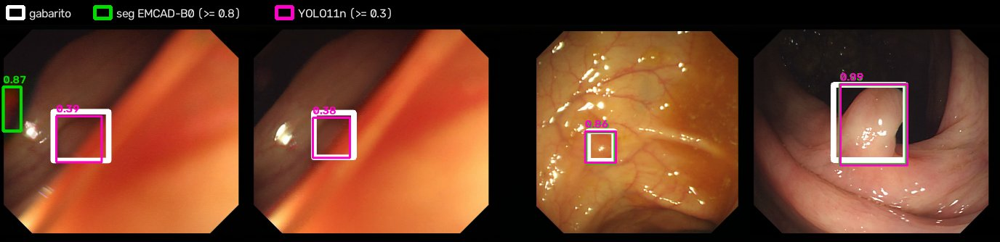
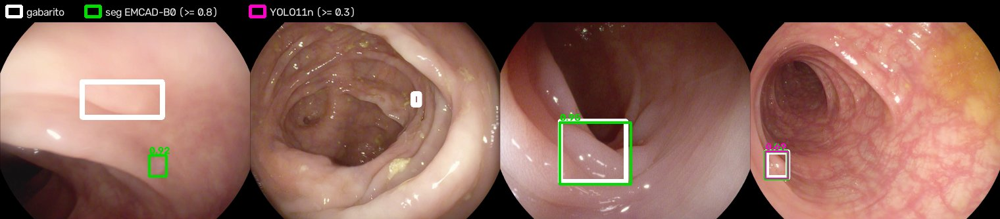
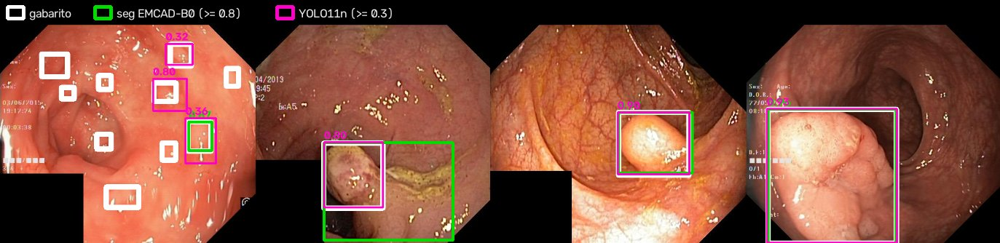
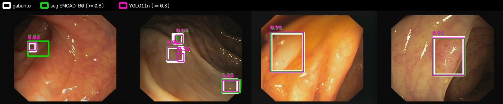
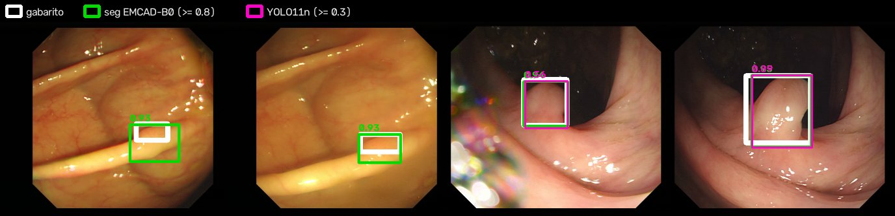

# Caixas (detecção) vs. segmentação

Pergunta: dá para marcar os pólipos só com caixas, sem segmentar? Comparamos dois caminhos com a **mesma métrica e os mesmos dados**.

1. **Caixas tiradas da segmentação.** Cada mancha prevista pelo EMCAD-B0 vira um retângulo, e a nota da caixa é a probabilidade média da mancha. Não exige treino novo.
2. **Detector YOLO11** (Ultralytics), treinado só com caixas. Ele usou as mesmas 1305 imagens de treino e as mesmas 145 de validação do EMCAD, com 100 épocas em 640 px numa T4 do Kaggle.

| Modelo | Parâmetros | Treino na T4 |
|---|---|---|
| YOLO11n | 2,6M | 22 min |
| YOLO11s | 9,4M | 28 min |
| EMCAD-B0 | 3,9M | ~45 min |

As **caixas de gabarito** vêm das máscaras: cada componente conexa vira uma caixa. Ruídos de anotação são descartados: menos de 0,05% da imagem ou menos de 5% do maior componente.

As métricas, de `pas/detection.py`, seguem o estilo COCO:
- **AP50 e AP50-95:** precisão média nos limiares de IoU de 0,5 e de 0,5 a 0,95;
- **best F1:** o melhor F1 com IoU ≥ 0,5, varrendo o limiar de confiança;
- **FP/img:** falsos positivos por imagem no limiar 0,5.

## Resultados

**AP50** (*conjuntos não vistos no treino*):

| Modelo | Kvasir | ClinicDB | *ColonDB* | *ETIS* | *CVC-300* | média não vistos |
|---|---|---|---|---|---|---|
| Seg EMCAD-B0 | 0.837 | 0.970 | 0.737 | 0.704 | 0.924 | 0.788 |
| Seg EMCAD-B0 + TTA (flip + multiescala) | 0.825 | 0.970 | 0.725 | **0.737** | **0.978** | 0.813 |
| **YOLO11n** | 0.857 | **0.991** | **0.834** | 0.709 | 0.949 | **0.831** |
| YOLO11s | **0.879** | **0.991** | 0.812 | 0.716 | 0.924 | 0.817 |

**AP50-95** (o quanto a caixa é justa):

| Modelo | Kvasir | ClinicDB | ColonDB | ETIS | CVC-300 |
|---|---|---|---|---|---|
| Seg EMCAD-B0 | 0.691 | 0.780 | 0.491 | 0.508 | 0.640 |
| Seg EMCAD-B0 + TTA | 0.679 | 0.800 | 0.468 | **0.552** | **0.688** |
| YOLO11n | 0.696 | **0.803** | 0.525 | 0.522 | 0.652 |
| YOLO11s | **0.708** | 0.785 | **0.529** | 0.532 | 0.648 |

**Melhor F1 e falsos positivos por imagem:**

| Modelo | best F1 ColonDB | best F1 ETIS | best F1 CVC-300 | FP/img ColonDB | FP/img ETIS |
|---|---|---|---|---|---|
| Seg EMCAD-B0 | 0.777 | 0.780 | 0.926 | 0.32 | 0.46 |
| Seg EMCAD-B0 + TTA | **0.788** | **0.784** | **0.983** | 0.30 | 0.35 |
| YOLO11n | **0.807** | 0.741 | 0.949 | **0.06** | **0.04** |
| YOLO11s | 0.761 | 0.724 | 0.920 | 0.08 | 0.07 |

As tabelas completas, com precisão, revocação e IoU médio, estão nos `.md`/`.json` desta pasta. As curvas de treino do YOLO estão em `yolo11*/results.png` e `BoxPR_curve.png`.

## O que isso diz

- **Faz sentido usar só caixas.** O YOLO11n, menor que o B0, tem o **melhor AP50 médio nos centros não vistos** (0,831). No ColonDB, ele fica +10 pontos acima das caixas da segmentação. A diferença vem de errar muito menos: 0,04 a 0,06 falso positivo por imagem, contra 0,3 a 0,5 da segmentação.
- **A segmentação ainda dá caixas melhores no ETIS e no CVC-300.** Com TTA, ela ganha em AP50-95 e em best F1 nesses conjuntos: as caixas ficam mais justas e acham mais pólipos pequenos. O YOLO perde revocação no ETIS: são 0,58 no limiar 0,5.
- **O YOLO11s não superou o 11n.** Com só 1305 imagens de treino, um modelo maior não ajuda. A vantagem real de treinar só com caixas é poder usar **bases muito maiores que só têm caixas**, como SUN, LDPolypVideo, KUMC e PolypGen, com dezenas de milhares de quadros. É justamente isso que ataca a generalização.

Ressalvas:
- é uma única seed;
- o YOLO roda em 640 px e o EMCAD em 352 px;
- as caixas de gabarito vêm das máscaras, e as bases não têm caixas nativas;
- a nota de uma caixa da segmentação é uma média de probabilidade, não uma confiança treinada para isso.

## Figuras

Em cada figura, as duas primeiras imagens são os piores casos das caixas da segmentação; as duas últimas são sorteadas.
- **Branco:** gabarito.
- **Verde:** caixa da segmentação com nota ≥ 0,8.
- **Magenta:** YOLO11n com nota ≥ 0,3.

Os limiares são os pontos de melhor F1 típicos de cada modelo.

**ColonDB.** No 1º e no 2º quadro, o YOLO acha os pólipos planos que a segmentação perde; no 1º, a segmentação ainda marca um falso positivo na borda.


**ETIS.** Os dois primeiros casos são difíceis para os dois modelos: um pólipo plano e um minúsculo.






## Como reproduzir

```bash
# caixas da segmentação (qualquer checkpoint do EMCAD)
python scripts/eval_boxes.py --checkpoint runs/emcad_b0/best.pth --out results/boxes/seg_emcad_b0
python scripts/eval_boxes.py --checkpoint runs/emcad_b0/best.pth --tta --scales 1.0 1.25 1.5 --out results/boxes/seg_emcad_b0_tta_ms
# YOLO11 no Kaggle: notebooks/kaggle_yolo.ipynb (mesmo fluxo do docs/rodar_kaggle.md); localmente:
python scripts/make_yolo_dataset.py --out yolo_data
yolo detect train data=yolo_data/data.yaml model=yolo11n.pt epochs=100 imgsz=640 batch=16 seed=42
python scripts/eval_boxes.py --yolo runs/detect/train/weights/best.pt --out results/boxes/yolo11n/boxes
# figuras
python scripts/render_boxes.py --preds "seg EMCAD-B0=results/boxes/seg_emcad_b0_tta_ms_preds.json:0.8" \
    "YOLO11n=results/boxes/yolo11n/boxes_preds.json:0.3" --out results/boxes/figures
```

O Ultralytics tem licença **AGPL-3.0**. Para pesquisa não há problema; num produto fechado, é preciso licença comercial ou trocar o detector por um com licença Apache, como o RT-DETR.
